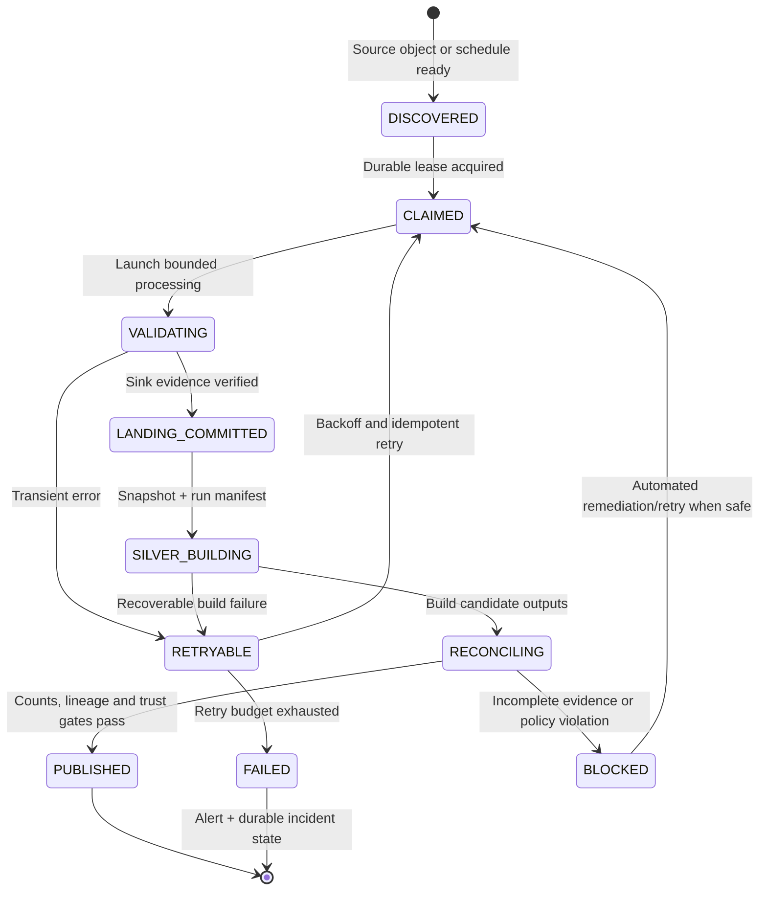

# ADR-GCP-004 — Payment Event Identity, Replay, Conflict Resolution and Deterministic Deduplication.

| Field | Value |
|---|---|
| Status | **Proposed — production-target design; not approved or deployed** |
| Date | 27 October 2026 |
| Decision owners | Payments Data AI architecture and data governance owners (formal names to be assigned) |
| Scope | GCP payment ingestion, validated landing, Silver, conflict handling, Gold and Consumption |
| Applies to | `project-e48f194e-f44f-458d-b4f`, development region `europe-west2`; production project and region TBD |
| Related decisions | Existing GCP Pub/Sub, governed GCS, Beam/Dataflow and BigQuery designs; reconcile ADR numbering and links in repository before acceptance |
| Classification | Architecture design; security and retention subject to governance approval |

## 1. Executive decision.

**Decision proposed:** Preserve the received event history in governed Bronze storage; allow at-least-once arrival and append-only validated landing observations; derive a deterministic, conflict-aware Silver representation keyed by a **namespaced event identity**; and expose only unambiguous or formally resolved event identities to trusted Gold and Consumption data products. Duplicate observations remain auditable. Conflicting payloads are never resolved by arrival order. Recovery, reprocessing, reconciliation and publication must be automated, with explicit safety gates.

This ADR specifies a **production-target contract**. It does **not** assert that the described Silver models, orchestration, conflict register, operational monitoring or cloud resources are deployed. At the time of writing, the known local evidence is Terraform validation and **23 passing Beam/Python tests**, including six preliminary idempotency tests. These tests do not establish cloud exactly-once delivery, deterministic BigQuery Silver processing, or operational recovery.

### Decision summary

| Concern | Decision | Reason |
|---|---|---|
| Source history | Governed, versioned GCS Bronze; immutable logical object identity and replay manifests | Forensic traceability and reproducible replay |
| Delivery | Assume at-least-once and partial sink success | Pub/Sub, export and processing can retry independently |
| Identity | `(source_system, event_id)` or a governed globally unique `event_id` contract; `payment_id` is **not** the deduplication key | Avoid cross-source collisions and preserve lifecycle transitions |
| Equality | Versioned canonical payload and SHA-256 fingerprint | Cross-runtime deterministic comparison |
| Landing | Append observations with provenance and processing metadata | Audit and replay evidence |
| Silver | One trusted canonical event per non-conflicted identity; deterministic materialisation | Stable analytical results |
| Conflicts | All distinct payload fingerprints for an identity trigger a conflict; no first-writer winner | Financial integrity |
| Resolution | Signed/authorised, append-only resolution decision; deterministic recomputation | Governance and accountability |
| Quarantine | Restricted security boundary, redaction/minimisation, retention and controlled reprocessing | Payment data sensitivity |
| Publication | Atomic or versioned publication of consistent Silver outputs, with reconciliation gates | Prevent mixed-state Gold results |
| Operations | Scheduled/data-ready orchestration, durable run state, idempotent retries, alerts and automatic recovery | No manual production triggers or routine recovery |

## 2. Context and problem statement.

The development architecture receives six-field payment events from producers via Pub/Sub, exports messages into governed GCS Bronze and uses Apache Beam/Dataflow to validate and write records to BigQuery. The validated table `pdm_payments_dev.payment_events` is currently an append-oriented landing table. Invalid events are routed to `pdm_payments_dev.payment_events_quarantine`. The GCS operational bucket for Dataflow staging/temp is separate from Bronze and has a seven-day lifecycle. The quarantine table currently has a **provisional** thirty-day partition expiry. These are development definitions, not approved production retention policies.

The six business fields currently defined are `event_id`, `payment_id`, `event_type`, `amount_minor`, `currency` and `event_timestamp`. The existing local Python classifier fingerprints those six fields and recognises repeated and conflicting identities. However, its first-seen choice is order-dependent and must **not** become the Silver trust rule. The existing BigQuery `WRITE_APPEND` sink can produce multiple rows for the same logical event after replays or retries. Valid and quarantine writes may succeed independently.

### Required outcomes

1. A retry or replay does not multiply a trusted logical payment event.
2. Legitimate multiple lifecycle events for one payment remain distinct.
3. Conflicting observations for an identity are detected independently of ingestion order.
4. Corrections and adjudications are explicit, authorised and auditable.
5. Failed runs can be safely retried without manual production recovery.
6. The platform can explain **which source object and processing run** contributed to every trusted record.
7. Gold/Consumption never silently receive unresolved conflicts or incomplete processing batches.
8. Storage, compute, BigQuery scans and monitoring remain subject to explicit cost controls.

## 3. Scope and boundaries.

**In scope:** Event identity; canonicalisation; provenance; validation; landing and quarantine; Silver deduplication and conflict management; replay manifests; deterministic transformation; publication; reconciliation; IAM and privacy boundaries; SLOs; deployment gates; test evidence.

**Out of scope for this ADR:** Settlement finality, transaction authorisation, ledger double-entry balancing, fraud model correctness, source-system business semantics beyond the six-field contract, enterprise MDM matching, and the separate Kafka/Flink-based open-source platform. Those concerns need linked decisions and data contracts.

**Environment distinction:** The current GCP project is a proof of concept. Production must use separate projects, service identities, environments, retention decisions, and approved budget thresholds. No cloud API enablement, `terraform apply`, Dataflow submission or billable work is authorised by this ADR.

## 4. Architecture views.

### 4.1 Logical component and trust-boundary view

```mermaid
flowchart LR
    subgraph EXT["Producer and transport boundary"]
      SRC(["Payment source systems"]) --> PUB{{"Pub/Sub topic + schema"}}
      PUB --> EXP["Managed GCS export"]
    end
    subgraph RAW["Governed immutable evidence boundary"]
      EXP --> BR[("GCS Bronze\nversioned source objects")]
      BR --> MAN["Object manifest + lineage"]
    end
    subgraph EXEC["Controlled processing boundary"]
      MAN --> ORCH(["Data-ready orchestration\nrun state + leases"])
      ORCH --> DF["Beam / Dataflow\nvalidation + provenance"]
      BR --> DF
    end
    subgraph DATA["BigQuery governed data boundary"]
      DF -->|valid| LAND[("Validated observations\nappend-only landing")]
      DF -->|invalid| QUAR[("Restricted quarantine")]
      LAND --> GROUP{{"Identity + canonical\nfingerprint evaluation"}}
      GROUP -->|one distinct fingerprint| SIL[("Silver canonical events")]
      GROUP -->|repeated same fingerprint| REPLAY[("Replay evidence")]
      GROUP -->|multiple fingerprints| CONFLICT[("Conflict register")]
      CONFLICT --> RES["Authorised resolution events"]
      RES -.-> GROUP
      SIL --> GATE{{"Reconciliation +\npublication gate"}}
      GATE --> GOLD[("Gold data products")]
      GOLD --> CONS[("Consumption / AI")]
    end
    ORCH -.-> MET(["Monitoring, alerting\nand recovery"])
    GATE -.-> MET
    classDef source fill:#dceafa,stroke:#5385b7,color:#17395c
    classDef trusted fill:#e0f0e6,stroke:#58926f,color:#1c4d35
    classDef risk fill:#fae7d8,stroke:#c38a45,color:#70431c
    classDef decision fill:#efe7f8,stroke:#8a68ad,color:#4b3270
    class SRC,PUB,EXP,BR,MAN,ORCH,DF source
    class LAND,SIL,REPLAY,GATE,GOLD,CONS trusted
    class QUAR,CONFLICT,RES,MET risk
    class GROUP decision
```



**Boundary rule:** The diagram is a *target state*. The existing landing/quarantine dataset does not yet enforce the separate restricted quarantine boundary. Silver, replay evidence, conflict register, publication gate and automated orchestration are design components pending implementation.

### 4.2 Event replay and conflict sequence

```mermaid
sequenceDiagram
    autonumber
    participant P as Producer
    participant B as Pub/Sub + Bronze
    participant D as Dataflow
    participant L as Landing
    participant S as Silver build
    participant C as Conflict register
    participant G as Gold gate
    P->>B: event_id=E1, payload=A
    B->>D: Deliver source object
    D->>L: Append observation E1/A + provenance
    B-->>D: Replay same source object
    D->>L: Append observation E1/A + new run ID
    S->>L: Read consistent bounded snapshot
    Note over S: One identity, one distinct fingerprint
    S->>G: Canonical E1/A, replay count=2
    P->>B: event_id=E1, payload=B
    B->>D: Deliver conflicting observation
    D->>L: Append observation E1/B
    S->>L: Re-evaluate identity E1
    Note over S: Two distinct fingerprints; no winner
    S->>C: Upsert conflict evidence E1/A and E1/B
    S-->>G: Withhold E1 until authorised resolution
```

**Correction rule:** A later authorised resolution is a new, immutable governance event referencing the disputed identity and chosen disposition. It does not delete or overwrite the historical observations. Publication must handle the transition from previously unambiguous to subsequently disputed identity: downstream models must be **recomputed or invalidated** for the affected identity; append-only Gold alone is insufficient.

### 4.3 Automated run-state and publication lifecycle



A durable state machine, leases, retry budgets and manifest checks are **required design controls**, not currently verified deployed components. Avoid marking a run complete merely because the Dataflow job reports success; confirm both sink outcomes and expected source coverage.

## 5. Data contracts and identity semantics.

### 5.1 Source event v1

| Field | Logical type | Required | Rule |
|---|---|---|---|
| `event_id` | STRING | Yes | Nonblank, source-stable across retries; uniqueness scoped by agreed source identity |
| `payment_id` | STRING | Yes | Nonblank; multiple event IDs per payment allowed |
| `event_type` | STRING | Yes | Versioned allowed-value catalogue; no arbitrary silent mapping |
| `amount_minor` | INT64 | Yes | Integer, within agreed source/currency/business bounds |
| `currency` | STRING | Yes | Approved ISO 4217 code and currency semantics |
| `event_timestamp` | TIMESTAMP | Yes | Valid instant, timezone explicit; UTC-normalised for canonicalisation |

**Critical contract gap:** The current six-field source event does not contain `source_system`, `schema_version`, `producer_sequence`, `correlation_id`, or explicit source object lineage. Before production, transport metadata or a v2 envelope must supply a stable **source namespace** and version. Until then, global uniqueness of `event_id` must be contractually guaranteed and tested; never invent a namespace from mutable ingestion details.

### 5.2 Identity and fingerprint

- Logical identity: `source_system || ':' || event_id` **if** the source namespace is available and governed. Otherwise use `event_id` only under a documented global uniqueness guarantee.
- Canonical business payload: the six business fields with a frozen schema and canonicalisation version.
- Fingerprint: `SHA256(canonical_bytes)`; record algorithm and canonicalisation version alongside every observation.
- JSON key order, Unicode handling, integer representation, timestamp offsets and fractional-second precision must be normalised identically in Python and BigQuery. **Do not assume** Python `json.dumps` and BigQuery `TO_JSON_STRING` are byte-equivalent.
- For v1, specify UTC RFC 3339 timestamps with a fixed precision (for example six fractional digits) and a deterministic field order/serialization; test with golden fixtures before deployment.
- An event fingerprint is an equality aid, **not** a cryptographic authenticity proof or a replacement for source signing and IAM.
- Fingerprints do not include processing timestamp, Dataflow job ID, file name or retry count.

### 5.3 Required landing metadata (target schema)

Keep existing business columns; add `source_system`, `schema_version`, `canonicalisation_version`, `event_fingerprint`, `source_bucket`, `source_object`, `source_generation`, `source_record_ordinal` (where reliably available), `ingestion_run_id`, `observed_at`, `validation_version`, and `source_manifest_id`. Use types and nullability agreed with producers and pipeline capabilities. **Do not fabricate an ordinal** if the export format does not guarantee record-level identity. For text exports, define and test line ordering and object-generation semantics.

The physical observation key should be derived from a stable source-object generation plus record position or another verified source identifier; a Dataflow run ID alone is not stable across replay. BigQuery does not enforce primary-key uniqueness, so application-level reconciliation remains mandatory.

## 6. Deterministic Silver algorithm.

For each bounded, consistent landing snapshot:

1. Validate canonicalisation version and reject or isolate unsupported versions.
2. Group observations by governed logical identity.
3. Count distinct **canonical fingerprints**, not observation rows.
4. If exactly one fingerprint exists, expose **one** canonical business event; retain duplicate count, first/last observation time and source lineage separately.
5. If more than one fingerprint exists, mark the identity `IDENTITY_CONFLICT`, preserve all variants and **exclude the identity** from trusted Silver.
6. If an authorised resolution exists, validate its signature/approval, target identity, referenced fingerprint(s), effective scope and revision; apply it deterministically and record the decision version.
7. Publish a consistent Silver snapshot only after run completeness, validation and reconciliation checks.

**Do not use** `ROW_NUMBER() OVER (PARTITION BY event_id ORDER BY observed_at)` as a conflict-resolution rule. A deterministic tie-breaker may choose a representative *observation* only after confirming one distinct business fingerprint; it must not decide between distinct payloads.

### 6.1 Illustrative BigQuery classification (design, not deployment SQL)

```sql
-- Target schema only: source_system and event_fingerprint are not
-- yet present in the currently defined development landing table.
WITH identities AS (
  SELECT
    source_system,
    event_id,
    COUNT(*) AS observation_count,
    COUNT(DISTINCT event_fingerprint) AS distinct_payload_count
  FROM `PROJECT_ID.DATASET.payment_event_observations`
  WHERE canonicalisation_version = 'v1'
  GROUP BY source_system, event_id
)
SELECT
  source_system,
  event_id,
  observation_count,
  distinct_payload_count,
  CASE
    WHEN distinct_payload_count = 1 THEN 'IDENTITY_VERIFIED'
    WHEN distinct_payload_count > 1 THEN 'IDENTITY_CONFLICT'
    ELSE 'INVALID'
  END AS identity_status
FROM identities;
```

This classification is a foundation, not a complete materialisation strategy. A production implementation must address unsupported versions, null fingerprints, authorised resolutions, late-arriving conflicts, transaction boundaries, incremental updates and partition pruning.

### 6.2 Materialisation and concurrency

**Preferred initial approach:** Build a bounded candidate Silver snapshot from a fixed landing watermark or manifest, verify it, then publish a versioned snapshot pointer. Gold reads the last approved snapshot. This is easier to reason about than direct concurrent `MERGE` operations for the first production release.

For later incremental processing, use an affected-identity change set, idempotent `MERGE`/delete-and-rebuild of affected identities, single-writer or transactional concurrency control, and a consistent published version. BigQuery `MERGE` does not itself guarantee end-to-end exactly-once ingestion. A late conflict must retract/invalidate previously trusted outputs and trigger dependent Gold rebuilds.

## 7. Conflict and quarantine governance.

### 7.1 Conflict register

Minimum fields: namespaced identity, distinct fingerprint set, source provenance, first/last detection time, detection run, classification version, status, severity, resolution reference, resolution revision and audit timestamps. Retain all distinct variants in a restricted evidence store; the register may contain hashes and references instead of unnecessary full raw payload copies.

Statuses: `OPEN`, `UNDER_REVIEW`, `RESOLVED`, `REJECTED`, `SUPERSEDED`. A resolution event must identify approver/authorising principal, reason, evidence references, approved disposition, effective timestamp and immutable audit ID. Resolve by policy or an authorised external decision; **do not require manual production DAG triggers or manual recovery**. Cases requiring human business judgement can remain quarantined while automated processing of unrelated identities continues.

### 7.2 Quarantine

Use a **separate restricted BigQuery dataset** (or equivalent access boundary), with its own service identity, IAM, audit logs, retention, authorised readers and minimised/redacted payload representation. Raw invalid payment payloads may contain sensitive identifiers; avoid unbounded raw copies and prevent them from appearing in application logs. The existing same-dataset quarantine is not an approved production boundary.

The development thirty-day partition expiry is **provisional**. Retention must be based on data classification, financial record-keeping obligations, investigation requirements, legal hold and deletion policy. Partition expiry alone is insufficient for legal holds or guaranteed immediate erasure. Define disposition and automated purge evidence before production.

### 7.3 Access-control matrix (target)

| Principal | Bronze | Landing | Quarantine | Silver/Gold | Administrative scope |
|---|---|---|---|---|---|
| Pub/Sub export service agent | Object create only | None | None | None | Bucket-scoped |
| Dataflow worker | Object read only | Append/write as required | Restricted write | None | Dataflow worker, minimum required job permissions |
| Silver transform identity | None or scoped read | Read | Restricted exception references | Write Silver candidate | Dataset-scoped |
| Gold publisher | None | None | None | Read approved Silver, write Gold | Snapshot-publish permission |
| BI/AI consumer | None | None | None | Read approved Consumption only | No project-wide data editor |
| CI/CD deployment identity | Terraform-scoped administration | Provisioning only | Provisioning only | Provisioning only | Workload identity federation, short-lived credentials |

Separate the Dataflow **service agent** from the Dataflow **worker service account**. Explicitly verify deployment `iam.serviceAccounts.actAs` and service-agent permissions. Do not use a human project Owner identity as the production deployer. Protect encryption keys, service accounts, audit logs and state backends according to organisational policy.

## 8. Automated orchestration, failure and replay semantics.

- Trigger bounded work from durable source manifests or scheduled/data-ready orchestration; never require routine manual DAG execution.
- Each run has a stable logical run key, input manifest, claimed lease, heartbeat, retry count, attempt IDs and terminal status.
- Retries must use the same logical manifest and must not publish duplicate trusted results.
- Source object generation is part of the manifest; avoid a mutable wildcard as the sole production replay boundary.
- Verify completeness of both valid and rejected outcomes, including zero-row outcomes, before marking ingestion committed.
- Reconciliation must account for **input records = valid observations + invalid observations + explicitly accounted-for processing failures**, using source-specific counting rules. Pub/Sub export files and Beam record counts require empirical verification.
- Use bounded exponential backoff, dead-letter/error states, stale lease recovery and automatic resubmission within policy.
- A nonrecoverable contract violation or identity conflict is not silently retried forever; isolate the affected records and continue safe independent processing.
- Maintain replay manifests and checkpoint/watermark history. Record lineage from published Silver snapshot back to source object generations and transformation versions.
- Ensure Dataflow `FILE_LOADS` staging/temp cleanup and quota limits; no production job should depend on a developer's local terminal session.

## 9. Operational SLOs, telemetry and cost controls.

**Targets below are proposed, not approved or measured.** Final numbers require workload profiling, source-system commitments and a production capacity test.

| Indicator | Proposed initial target | Measurement / alert |
|---|---|---|
| Input manifest completeness | 100% of admitted bounded inputs accounted for | Source-vs-sink reconciliation; block publication on mismatch |
| Trusted Silver duplicate identities | 0 per published snapshot | Uniqueness test on namespaced identity |
| Unresolved conflicts published as trusted | 0 | Conflict-exclusion test; block affected identities |
| Idempotent replay | Same trusted snapshot for same manifest and rules | Hash/diff regression test |
| Ingestion-to-trusted freshness | Define after load testing; candidate 30 minutes for bounded POC | p50/p95 lag; alert on agreed breach |
| Recovery | Automated retries; target RTO/RPO to be agreed | Lease, retries, failed runs, backlog |
| Quarantine governance | 100% of rejected events accounted for and access audited | Access logs, expiry and disposition checks |
| Spend | Approved environment-specific budget and forecast | GCP billing budgets, anomaly alerts, usage metrics |

Track source objects/bytes, Pub/Sub backlog, Dataflow failures and worker-hours, validated/rejected counts, replay rate, distinct conflict identities, Silver publication age, reconciliation deltas, BigQuery bytes scanned/loaded, GCS lifecycle backlog and IAM anomalies. Integrate with Cloud Monitoring or a justified portable metrics stack; record alert ownership and escalation. Budget alerts are **not hard spending caps**. Before deployment, estimate fixed and variable costs for Pub/Sub, GCS, Dataflow workers, BigQuery storage/queries/load operations, logging and network egress, and verify trial-credit eligibility and expiry.

## 10. Security, privacy and regulatory controls.

Use encryption in transit and at rest, uniform bucket access, public-access prevention, least privilege, separate environments, protected Terraform state, short-lived CI/CD credentials and audit logging. Define data classification, PCI DSS applicability (if cardholder data is involved), UK GDPR/other applicable privacy requirements, regional residency and lawful retention with compliance owners. **No regulatory compliance claim is made by this ADR.** Use synthetic payment data for development unless a formally approved dataset is provided. Threat-model spoofed events, payload substitution, replay floods, privilege escalation, malicious schema evolution, quarantine exfiltration and tampered resolution records.

## 11. Alternatives and trade-offs.

| Alternative | Decision | Reason |
|---|---|---|
| Deduplicate by `payment_id` | Rejected | Discards legitimate lifecycle transitions |
| Drop duplicates in Bronze | Rejected | Removes replay and forensic evidence |
| First-arrival-wins | Rejected | Order-dependent, unsafe for financial data |
| Trust BigQuery `WRITE_APPEND` as exactly-once | Rejected | No end-to-end idempotency guarantee |
| Direct `MERGE` to trusted Silver without staging | Deferred | Harder to manage partial runs, late conflicts and publication consistency |
| Versioned candidate Silver with reconciliation gate | **Proposed** | Deterministic, auditable, easier rollback and publication control |
| Human review for every replay | Rejected | Violates automation requirement and creates operational bottleneck |

**Consequences:** Additional provenance fields, data storage, candidate snapshots, SQL/dbt transformations, conflict evidence, testing and operational metrics. In return, trusted outputs are reproducible and failures become diagnosable. Additional cost is justified only after workload and budget review.

## 12. Production acceptance criteria and evidence matrix.

| Gate | Required evidence | Current status |
|---|---|---|
| ADR review | Named architecture, security, governance and operations approvals | **Open** |
| Source identity | Producer uniqueness contract, source namespace, schema/version policy | **Open** |
| Canonicalisation | Golden fixtures for Python ↔ BigQuery including offsets, Unicode, negative/large integers, null/error handling | **Open** |
| Replay tests | Repeated same object, distinct objects, reordered inputs, retries, concurrent attempts | **Open** |
| Conflict tests | All fingerprint variants detected; arrival-order independence; late-conflict retraction | **Open** |
| Silver SQL/dbt | Unique/not-null keys, referential and accepted-value tests, deterministic snapshots | **Open** |
| Publication gate | Manifest completeness, sink reconciliation, atomic/versioned publish, rollback | **Open** |
| Security | Dedicated quarantine boundary, IAM review, threat model, audit and retention approval | **Open** |
| Operations | Durable leases, automated retries, recovery, alerts, failure injection, RTO/RPO | **Open** |
| Infrastructure | Terraform plan reviewed, APIs/IAM verified, region/quotas and budget approved | **Open** |
| Local foundation | Terraform validation and 23 local tests | **Observed PASS** |
| Cloud integration | Pub/Sub export format, Beam/Dataflow sink behaviour, BigQuery, lineage, failure paths | **Not executed** |

### Required test scenarios

1. Exact duplicate: one Silver identity, two observation records.
2. Different lifecycle event IDs for one payment: both retained.
3. Same identity, changed amount/currency/timestamp: conflict, no trusted winner.
4. Reverse input order and parallel input: identical conflict outcome.
5. Late conflicting event after Silver publication: invalidation/rebuild and dependent Gold refresh.
6. Reprocess same Bronze object generation: no changed trusted result.
7. Partially successful valid/quarantine sinks: no premature run completion.
8. Crash after landing before publication: automatic recovery without duplicate trusted events.
9. Expired lease and retry overlap: single logical publication.
10. Cross-runtime fingerprint fixture parity and schema-version transition.
11. Access denied for unauthorised quarantine and Bronze writers.
12. Budget, quota and service outage tests with controlled failure handling.

## 13. Implementation and rollout plan.

**Phase 0 — Approve contracts and security:** Finalise source namespace, canonicalisation v1, timestamp rules, quarantine dataset and retention, source manifest format, IAM and cost envelope. Record explicit approvals.

**Phase 1 — Local implementation:** Extend landing metadata and Beam contracts; add golden fixtures; implement SQL/dbt identity classification, conflict evidence, canonical Silver and replay metrics. Update dedicated GCP CI to run new tests. Use synthetic data and local/static tests.

**Phase 2 — Controlled cloud integration (approval required):** Review Terraform plan and IAM, verify enabled APIs/service agents and billing controls, provision development resources, execute bounded synthetic Pub/Sub→GCS→Dataflow→BigQuery runs, validate export line format and sink behaviour, run replay and fault injection. Set a fixed spending/time limit.

**Phase 3 — Operational hardening:** Implement durable run state, source manifests, automatic recovery, snapshot publication, monitoring, retention, incident ownership and lineage. Prove late-conflict invalidation and backfills.

**Phase 4 — Production readiness review:** Approve threat model, compliance/retention, SLOs, RTO/RPO, disaster recovery, deployment identities, capacity/cost and test evidence. Conduct change-controlled deployment and rollback rehearsal. Mark ADR **Accepted** only after architecture approvals; mark implementation **Production Ready** only after evidence gates pass.

## 14. Rollback and migration.

Retain current validated landing observations and immutable Bronze history. Introduce additional metadata and Silver candidate outputs in parallel; do not destructively rewrite historical landing tables without a documented migration. Compare candidate and existing analytical results on a fixed manifest, including duplicates/conflicts. Switch Gold/Consumption to an approved snapshot pointer only after reconciliation. Rollback by restoring the prior published pointer; do not erase conflict evidence or source history. Any migration of the current quarantine table to a restricted dataset must preserve governed retention and audit evidence.

## 15. Open decisions requiring sign-off.

1. Are `event_id` values globally unique, or is `source_system` required in the event envelope?
2. What exact timestamp precision and JSON canonicalisation standard will Python and BigQuery share?
3. Which lifecycle event types and amount rules are valid per payment rail?
4. What are the legally approved retention periods and hold procedures for Bronze, landing, quarantine and conflicts?
5. What is the approved conflict-resolution authority and audit format?
6. What are the production freshness, RTO, RPO, throughput and cost ceilings?
7. Which orchestration and durable-run implementation will be used in the GCP deployment?
8. What is the production dataset/project separation and approved regional residency?
9. How will source manifests prove Pub/Sub export completeness and record-level provenance?
10. What publication strategy and dependent Gold invalidation mechanism is approved?

## 16. Decision record and change control.

| Revision | Date | Change | Approval |
|---|---|---|---|
| 0.1 | 2026-10-27 | Production-target architecture, contracts, diagrams, security and operational gates drafted | Pending |

**Decision status remains Proposed.** This document is complete as a design review artefact but intentionally lists unimplemented and unverified controls. Any change to identity, canonicalisation, conflict disposition or trust/publication semantics requires an ADR revision and regression evidence. Repository links, owners and signatories must be populated during formal review.
