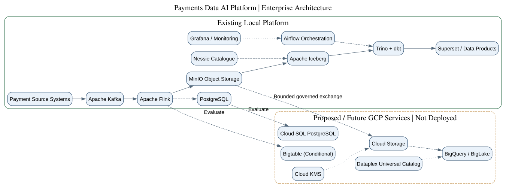
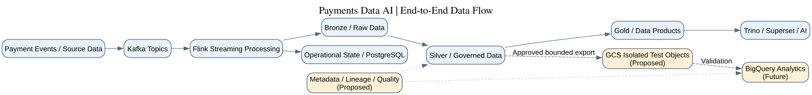
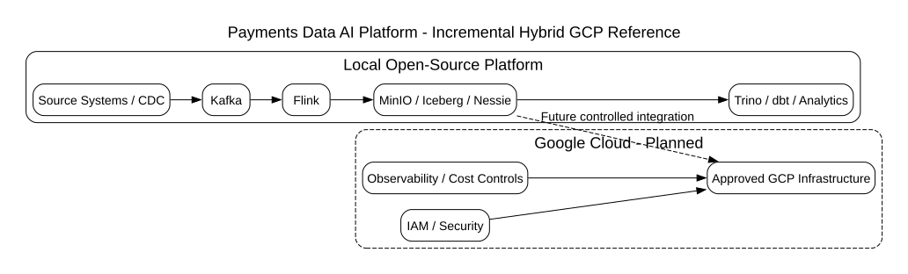
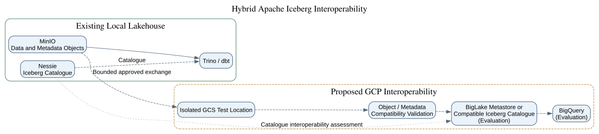
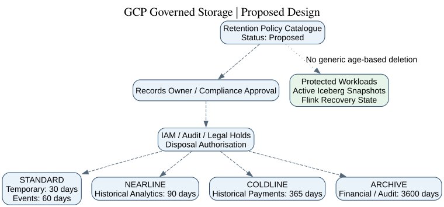

# Payments Data AI Platform.
## Google Cloud Hybrid Reference Architecture.

> **Architecture status:** Proposed and under incremental validation.  
> **Deployment approach:** Open-source-first, hybrid and Terraform-managed.  
> **Cloud provisioning:** Requires explicit approval.

---

## Executive Overview.

The Payments Data AI Platform provides an extensible foundation for
payment event processing, governed data products, historical analytics
and AI-enabled operational intelligence.

The existing local open-source implementation remains the reference
baseline. Google Cloud capabilities are evaluated incrementally,
with interoperability, security, resilience and cost controls.

## Enterprise Architecture.

[Full-size diagram](diagrams/enterprise-platform.svg) |
[Graphviz source](diagrams/enterprise-platform.dot)

## End-to-End Data Flow.

[Full-size diagram](diagrams/end-to-end-data-flow.svg) |
[Graphviz source](diagrams/end-to-end-data-flow.dot)

## Hybrid Deployment Architecture.

[Full-size diagram](diagrams/hybrid-reference.svg) |
[Graphviz source](diagrams/hybrid-reference.dot)

## Apache Iceberg Lakehouse.

[Full-size diagram](diagrams/iceberg-lakehouse.svg) |
[Graphviz source](diagrams/iceberg-lakehouse.dot)

## Governed Storage Architecture.

[Full-size diagram](diagrams/governed-storage.svg) |
[Graphviz source](diagrams/governed-storage.dot)

## Technology Responsibilities.

| Capability | Existing reference platform | GCP direction |
|---|---|---|
| Event streaming | Apache Kafka | Preserve and evaluate integration |
| Stream processing | Apache Flink | Preserve and evaluate integration |
| Object storage | MinIO | Governed Cloud Storage |
| Open table format | Apache Iceberg | Iceberg on GCS |
| Table catalogue | Nessie | Catalogue interoperability assessment |
| SQL analytics | Trino, dbt | BigQuery and BigLake evaluation |
| Operational database | PostgreSQL | Cloud SQL assessment |
| Low-latency state | Kafka/Flink/PostgreSQL | Bigtable conditional assessment |
| Orchestration | Apache Airflow | Automated hybrid orchestration |
| Governance | Platform governance controls | Dataplex evaluation |
| Encryption keys | Existing platform controls | Cloud KMS evaluation |
| Infrastructure as code | Terraform | Terraform GCP modules |
| Observability | Grafana and platform monitoring | Hybrid observability |

## Architecture Decision Records.

| Record | Decision |
|---|---|
| [ADR-000](../../adr/ADR-000-Payments-Data-AI-Platform-Architecture.md) | Enterprise platform architecture |
| [ADR-GCP-001](../../adr/ADR-GCP-001-Incremental-Hybrid-Deployment.md) | Incremental hybrid deployment |
| [ADR-GCP-002](../../adr/ADR-GCP-002-Hybrid-Lakehouse-Storage-Interoperability.md) | Lakehouse interoperability |
| [ADR-GCP-003](../../adr/ADR-GCP-003-Governed-Cloud-Storage-Retention.md) | Governed cloud storage and retention |

## Deployment and Governance Boundaries.

The diagrams describe the reference and target architecture.
They do not establish that proposed GCP services are running.

No GCP resources are authorised for provisioning by this document.
Storage retention enforcement, deletion and retention locking
require their respective approvals.

Active Iceberg metadata and Flink recovery state remain protected
under the existing platform architecture.

## Diagram Maintenance.

Graphviz `.dot` files are the editable sources. SVG files are
the rendered diagrams embedded in these Markdown documents.

Both formats should be reviewed and committed together whenever
an architecture diagram changes.
